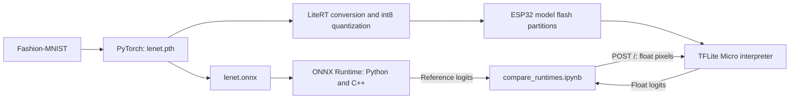
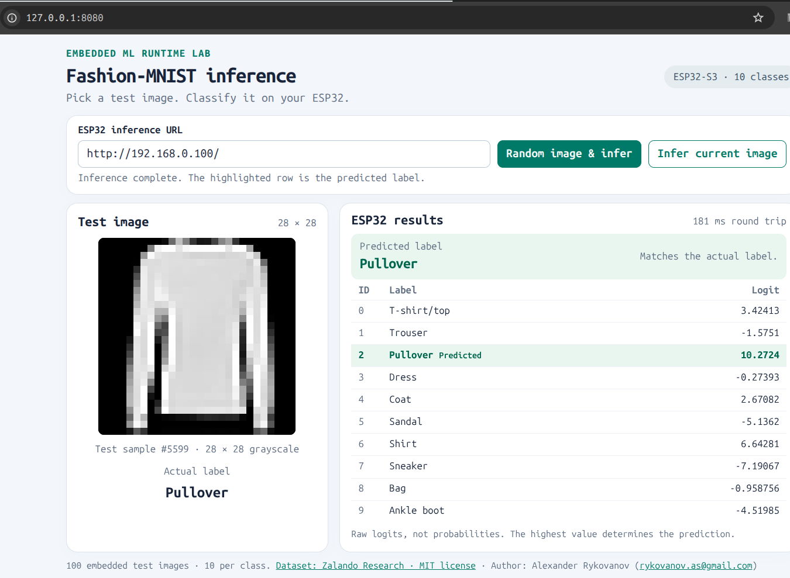
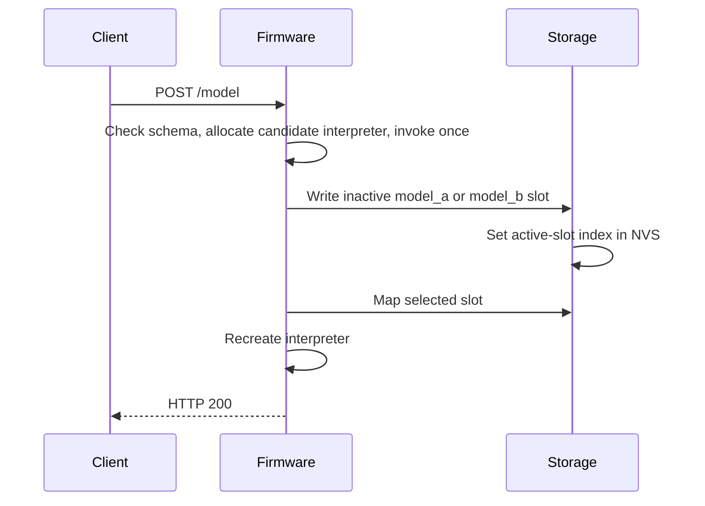

# AI Engineering Experiments

A learning project that trains a LeNet-like classifier on Fashion-MNIST,
compares runtimes, and runs int8 inference on an ESP32-S3. Models can be
replaced over HTTP without rebooting the board.

## Architecture and data flow



* [model/](model/): training, export, quantization, comparisons, HTTP clients.
* [main.cpp](main.cpp), [cpp/](cpp/): C++ ONNX inference, custom ReLU, tests.
* [esp32/main/](esp32/main/): HTTP handlers, interpreter lifecycle, flash storage.

Input: one grayscale image, `[1, 1, 28, 28]`, with pixels scaled to `[0, 1]`.
The firmware quantizes floats to int8 and dequantizes the 10 output logits.
The predicted class is the index of the largest logit.

## Reproduce on Linux

Requirements: Python 3.12, GCC 14, CMake 3.28.3+, and GoogleTest.
Commands start at the repository root unless stated otherwise.

```bash
python3.12 -m venv .venv
source .venv/bin/activate
python -m pip install -r requirements.txt
jupyter notebook --notebook-dir=model
```

Run notebook cells in order:

| Notebook | Purpose |
| --- | --- |
| [train_model.ipynb](model/train_model.ipynb) | Download data, train `lenet.pth`, save sample tensors |
| [onnx_details.ipynb](model/onnx_details.ipynb) | Export `lenet.onnx`, inspect graphs, profile ONNX Runtime |
| [quantization.ipynb](model/quantization.ipynb) | Export float TFLite, calibrate and quantize to int8 |
| [compare_runtimes.ipynb](model/compare_runtimes.ipynb) | Compare PyTorch, Python/C++ ONNX Runtime, and ESP32 predictions |

### C++ inference and local tests

Install GoogleTest through your system package manager. Supply an ONNX Runtime
shared library matching the bundled **1.30.1** headers under `onnxruntime/lib/`,
including `libonnxruntime.so` and its versioned targets. These libraries are
ignored by Git; the Python package does not populate this directory.

```bash
cmake -S . -B build -DCMAKE_BUILD_TYPE=Release
cmake --build build --parallel
./build/onnx_exporter_test
./build/onnx_exporter model/lenet.onnx
```

Run from the repository root: the executable reads `model/sample_images.bin`
and writes `model/cpp_logits.bin`. The comparison notebook also invokes it.

### ESP32 firmware

The lockfile records ESP-IDF **5.5.6**, `esp-tflite-micro` **1.4.3**, and
`esp-nn` **1.5.0**. Follow the
[ESP-IDF setup guide](https://docs.espressif.com/projects/esp-idf/en/v5.5/esp32s3/get-started/index.html).
The saved configuration targets an ESP32-S3 with **16 MB flash and octal PSRAM**;
adjust it with `idf.py menuconfig` for other hardware.

In a separate terminal, replace the SDK path and serial port:

```bash
source /path/to/esp-idf/export.sh
cd esp32
idf.py build
idf.py -p /dev/ttyACM0 flash monitor
```

The flash target also writes `model/lenet_quantized.tflite` to `model_a`.
Provision Wi-Fi over BLE using service `ARM_PREP` and the proof-of-possession
value in [ryk_wifi.cpp](esp32/main/ryk_wifi.cpp). Read the IP from the serial log.
The client must be able to reach that address.

## HTTP interface

| Endpoint | Request | Success |
| --- | --- | --- |
| `GET /` | No body | `Hello` |
| `POST /` | Text: `784` followed by 784 floats; maximum 16 KiB | Text: `10` followed by 10 logits |
| `POST /model` | Raw `.tflite` bytes; maximum 1 MiB | HTTP 200, empty body |

Numbers are space-separated. POST requires `Content-Length`; the Python clients
provide it. Invalid input returns HTTP 400; model/inference failures return 500.
Transport failures can close the connection.

Replace the board IP in `compare_runtimes.ipynb`. For one saved image:

```python
logits = lenet.esp32_inference(X[0], "http://192.168.1.123/")
predicted_label = logits.argmax()
```

Upload a compatible model from the repository root:

```bash
python model/esp32_update_model.py model/lenet_quantized.tflite \
  --url http://192.168.1.123/ --timeout 30
```

## Web UI

The [two-file UI](esp32/ui/) uses HTML and vanilla JavaScript, with 100 embedded
Fashion-MNIST test images: 10 per class. It displays the selected image, its actual
label, and all 10 logits returned by the ESP32, highlighting the predicted class.

Serve it from the repository root:

```bash
python3 -m http.server 8080 --bind 127.0.0.1 --directory esp32/ui
```

Open [http://localhost:8080](http://localhost:8080), enter the ESP32 inference URL,
and click **Random image & infer**. Use **Infer current image** to retry the same
sample. The current firmware includes the CORS header required for browser access.



## Model replacement



Each slot is 1 MiB. `ModelStorage` manages flash mappings; TFLite model pointers
borrow that storage. The interpreter uses a 19 KiB tensor arena. Global model
and NVS objects survive `app_main` returning.

## Results and interpretation

Saved notebook outputs, not newly measured results:

| Measurement | Result | Scope |
| --- | --- | --- |
| PyTorch accuracy | 89.3% | 10,000 test images |
| Float TFLite accuracy | 87.5% | 64 saved images |
| Int8 TFLite accuracy | 85.94% | Same 64 images |
| TFLite file size | 603.66 → 162.88 KiB | Float → int8; about 3.7× smaller |

Quantization changes logits and can change labels; the comparison notebook
shows an ESP32/PyTorch disagreement. Its `1e-5` tolerance checks float ONNX/PyTorch
agreement, not int8 equivalence.

ONNX profiling compares disabled and extended optimizations over 64 images
repeated 1,000 times after warm-up. Profiling adds overhead; summed event durations
are not per-inference means. HTTP round-trip time also includes networking,
text conversion, and quantization. Standalone ESP32 inference latency is not reported.

## Limitations

* The 64 saved images come from a training batch and are reused for calibration;
  their accuracy is not an independent test-set estimate.
* Replacement models must retain the expected int8 format, 784 inputs, 10 outputs,
  supported operators, and fit the tensor arena.
* Updates are experimental: rollback and power-loss recovery are not guaranteed.
  Flash erase is commented out, NVS writes are not explicitly committed, and
  repeated mappings are not released during replacement.
* HTTP requests are synchronous. There is no HTTP authentication or TLS;
  fixed provisioning credentials are intended for a local lab.
* Reproduction requires an external C++ ONNX Runtime library and matching board
  configuration. Exact laptop hardware and a clean-machine setup are not recorded.
